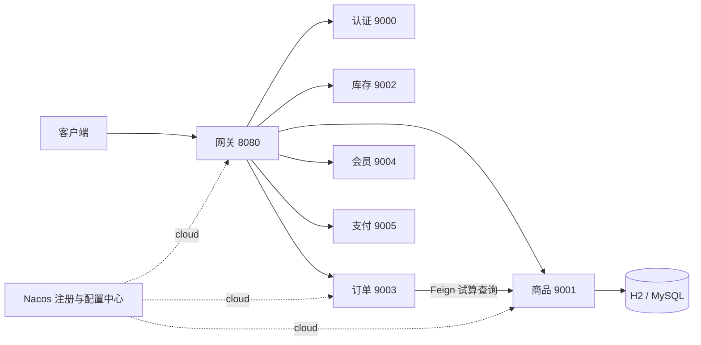

# SelfMall 自营电商微服务框架

Java 21 + Spring Boot 3.5.0 + Spring Cloud 2025.0.0 + Spring Cloud Alibaba 2025.0.0.0，Maven 多模块项目。

上线基线保存在 `main`，开发分支为 `develop`。镜像发布、生产参数、独立迁移、验收检查和回滚流程见 [上线说明](docs/RELEASE.md)。当前业务仍为框架，正式发布检查默认保持阻断，需完成真实业务和环境验收。

版本按 [Spring Cloud Alibaba 官方兼容矩阵](https://sca.aliyun.com/docs/2025.x/overview/version-explain/) 配套锁定。此处是可开发、可运行的后端起步框架；上线前应升级并回归同系列维护版本，完成真实账号、权限、交易和基础设施治理。

## 模块

| 模块 | 端口 | 当前能力 |
| --- | --- | --- |
| mall-gateway | 8080 | WebFlux 网关、显式路由、JWT 校验；cloud 使用 Nacos 服务发现 |
| mall-auth | 9000 | local 演示登录和 JWT 签发；cloud 不提供演示登录 |
| mall-product | 9001 | 商品分页、详情、JDBC 持久化、Flyway 迁移；local H2，cloud MySQL |
| mall-inventory | 9002 | 库存服务启动骨架，预留库存流水、预占、释放业务 |
| mall-order | 9003 | JWT 身份校验、Feign 商品查询、服务端价格试算 |
| mall-member | 9004 | 从 JWT 获取当前会员 ID；预留会员资料、收货地址 |
| mall-payment | 9005 | 支付服务启动骨架，预留支付单、回调、退款、对账业务 |
| mall-common-core | — | 统一响应、跨服务商品查询 DTO |
| mall-common-security | — | JWT 密钥及 issuer、audience、过期校验 |
| mall-common-web | — | Servlet 安全配置、参数校验、异常处理自动配置 |

网关不依赖 Servlet 公共模块。业务服务独立验证 JWT，身份不从客户端传来的用户 ID 请求头读取。金额采用 `BigDecimal` 和 `DECIMAL(12,2)`。



## 1. 本地直接启动（无需 Docker）

前提：JDK 21，首次构建可以访问 Maven Central。无需预装 Maven，Wrapper 固定 Maven 3.9.11。

```powershell
.\mvnw.cmd clean verify
```

Linux/macOS 使用 `bash mvnw clean verify`。IDE 导入根目录 `pom.xml`，项目 SDK 选 21。

在多个终端分别运行：

```powershell
.\scripts\run-service.ps1 gateway
.\scripts\run-service.ps1 auth
.\scripts\run-service.ps1 product
.\scripts\run-service.ps1 order
.\scripts\run-service.ps1 member
# 按需启动骨架服务
.\scripts\run-service.ps1 inventory
.\scripts\run-service.ps1 payment
```

也可直接执行，例如：

```sh
java -jar mall-product/target/mall-product-0.1.0-SNAPSHOT.jar --spring.profiles.active=local
```

默认 profile 为 `local`：关闭 Nacos、Sentinel 和 Redis 自动配置，商品使用内存 H2，自动迁移并插入一条示例商品。重启商品服务会丢失本地数据。cloud 不加载示例数据脚本。

### 调用示例（PowerShell）

```powershell
Invoke-RestMethod http://localhost:8080/api/products/1
$login = Invoke-RestMethod http://localhost:8080/api/auth/token -Method Post `
  -ContentType 'application/json' -Body '{"username":"demo","password":"demo123456"}'
$headers = @{ Authorization = "Bearer $($login.data.accessToken)" }
Invoke-RestMethod http://localhost:8080/api/orders/quote -Method Post -Headers $headers `
  -ContentType 'application/json' -Body '{"productId":1,"quantity":2}'
Invoke-RestMethod http://localhost:8080/api/members/me -Headers $headers
```

试算返回会员 `10001`、单价 `99.00`、金额 `198.00`。这不是创建订单，不扣库存、不发起支付，不包含优惠、运费及税费计算。

演示账号 `demo / demo123456` 只存在于 `local & !cloud`。可通过 `MALL_DEMO_PASSWORD` 更改密码。JWT 有效期 1 小时；本地默认密钥仅用于开发。cloud 必须提供 `MALL_JWT_SECRET`（至少 32 字节，所有服务一致），且不允许使用 local 默认密钥部署。生产建议用独立身份服务和非对称签名/JWKS，减少共享签名密钥的范围。

## 2. Alibaba 中间件开发环境

先启动 Docker 引擎：

```powershell
Copy-Item deploy/.env.example deploy/.env
# 按需修改 deploy/.env 中的本地密码
docker compose --env-file deploy/.env -f deploy/compose.yml up -d
```

提供 MySQL 8.4.5、Redis 7.4.3、Nacos 3.0.3。端口只绑定 `127.0.0.1`。Nacos 控制台为 [localhost:8088](http://localhost:8088)，客户端使用 8848/9848。本地 Compose 关闭 Nacos API 鉴权；仅用于本机开发，不作为生产部署模板。控制台如要求初始化管理员，请按界面完成。

将 `deploy/nacos/*.yml` 分别导入 Nacos：Data ID 与文件名一致、Group 为 `SELF_MALL`、namespace 默认 public。cloud 使用必需的 `spring.config.import=nacos:...`，缺少配置/连接失败时启动失败；不要使用旧 `bootstrap.yml`。详见 [官方 Nacos 接入说明](https://sca.aliyun.com/docs/2025.x/user-guide/nacos/advanced-guide/)。当前版本的远程配置热更新存在上游问题，本框架不依赖热更新；修改配置后重启验证。

在启动 cloud 服务的终端设置环境变量（每个终端均需设置）：

```powershell
$env:MALL_JWT_SECRET = 'replace-with-your-own-random-secret-at-least-32-bytes'
$env:NACOS_SERVER_ADDR = 'localhost:8848'
# 本地 Compose 未开启 API 鉴权；占位凭据不用于实际鉴权
$env:NACOS_USERNAME = 'nacos'
$env:NACOS_PASSWORD = 'local-unused'
$env:MYSQL_USERNAME = 'mall_product'
$env:MYSQL_PASSWORD = 'localProductChangeMe2026' # 与 deploy/.env 一致
$env:REDIS_PASSWORD = 'localRedisChangeMe2026'   # 与 deploy/.env 一致
.\scripts\run-service.ps1 product -Profile cloud
```

其他服务同理。`deploy/.env` 供 Compose 读取，不会自动导入 Java 进程的环境变量。服务运行在宿主机，Nacos/数据库运行在 Docker；如果把 Java 服务也容器化，需要将 localhost 改成对应容器服务名。

cloud 商品库初始为空。业务服务骨架尚未配置各自的数据源；后续按服务独立建库、独立账号，禁止跨服务直接查表。商品服务 Redis 客户端已接入，业务缓存策略尚未实现。数据库迁移当前由启动时 Flyway 执行；生产应由独立迁移任务执行并收紧运行账号权限。

cloud 的认证服务当前只提供健康检查，接入真实身份系统后才可登录。不能将 local 演示登录用于线上账号认证。

### Sentinel、RocketMQ 与 Seata

- Servlet 业务服务接入 Sentinel starter，cloud 可通过 `SENTINEL_DASHBOARD` 设置控制台（默认 localhost:8858）。控制台需另行启动；尚未提供限流规则持久化、业务资源规则或网关 Sentinel 适配。
- RocketMQ 5.3.1 和 Seata 2.5.0 的依赖通过 Maven profile `alibaba-extended` 引入订单、库存服务，避免基础开发环境强依赖全部中间件。
- 构建扩展：`.\mvnw.cmd -Palibaba-extended clean verify`；启动可选容器：`docker compose --env-file deploy/.env -f deploy/compose.yml --profile extended up -d`。
- 当前 `seata.enabled=false`，没有开启全局事务；RocketMQ 尚未配置 binding，也没有消息生产/消费实现。不能把“依赖可构建”理解为交易一致性已经完成。
- 集成 Seata 前，为参与事务的服务配置 JDBC 数据源、事务组、服务映射及 `undo_log`；先验证本地事务，再设计跨服务回滚边界。
- 集成 RocketMQ 前，创建业务 Topic、配置 binding/group，并实现消息幂等、重试、死信告警及补偿任务；本地 broker 禁止自动建 Topic，公告地址为 127.0.0.1。
- 可选容器是本地开发模板，未包含高可用、生产账号体系及存储容量规划。

## 3. 验证

Kubernetes 部署文件位于 `deploy/k8s/`，包含 dev/prod Kustomize、Deployment/Service、健康探针、HPA/PDB、Ingress 和 Secret 示例。镜像构建及发布步骤见 [Kubernetes 部署说明](deploy/k8s/README.md)。

```powershell
.\mvnw.cmd clean verify
# 要求 Python 3；占用 8080、9000–9005，运行前先停止手动启动的服务
python scripts/smoke-test.py
```

集成测试覆盖 H2/Flyway 商品查询、404、分页边界、服务鉴权、试算金额和数量校验。冒烟脚本实际启动全部七个服务，验证网关路由、真实 JWT 签发/校验、Feign 查询、篡改 token 拦截以及商品服务中断时的 503；结束后回收由脚本启动的进程。日志位于 `.tools/smoke-logs/`。

健康检查：`GET /actuator/health`。仅暴露 health、info；health 可匿名访问，其他接口按安全规则认证。业务异常使用 `ApiResponse`；Security 的 401/403 和网关原生错误保留框架格式。CI 在 Java 21 上执行 Maven verify。

## 后续业务开发顺序

1. 会员与后台管理员身份体系、密码哈希、刷新/撤销令牌、RBAC 及数据权限。
2. 商品 SPU/SKU、类目、上下架、商品图片与 OSS；库存预占和流水。
3. 购物车、订单状态机、幂等下单、价格快照、超时关单和库存释放。
4. 支付渠道签名校验、回调幂等、支付单状态机、退款和对账。
5. 消息事务/Outbox、失败补偿、限流持久化、审计、追踪、监控告警和压测。

当前没有商城前端、运营后台页面、真实下单/扣库存/支付功能。
